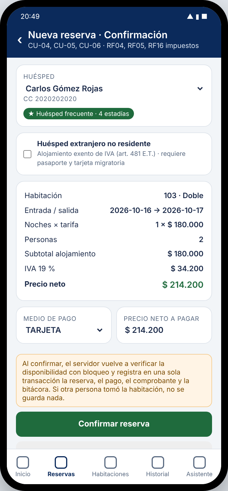
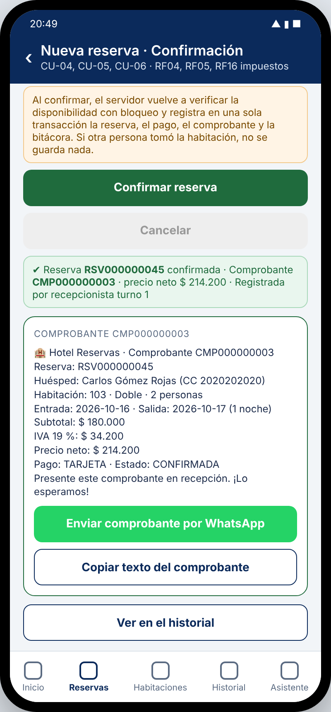
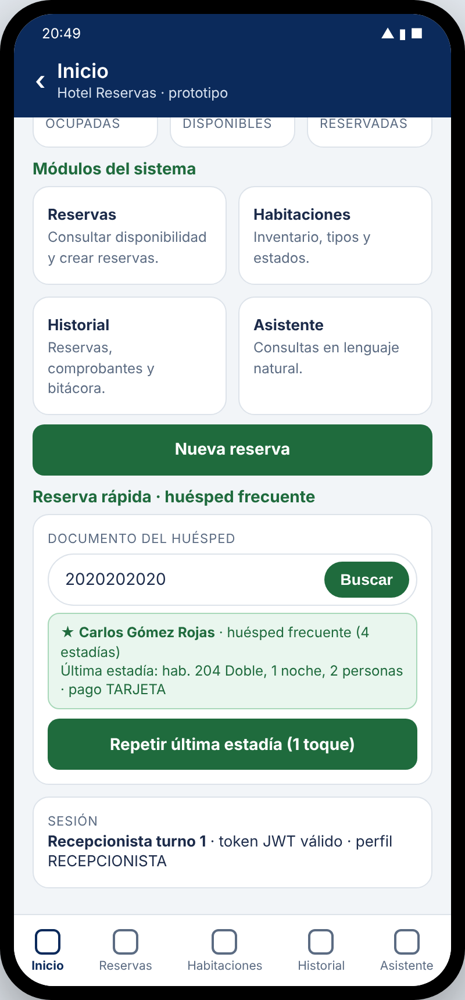
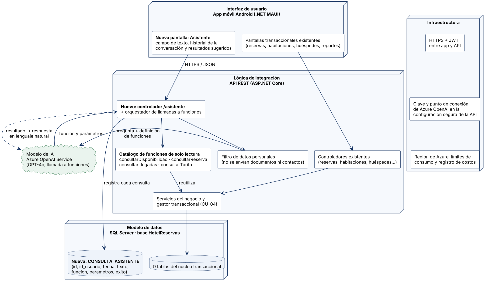
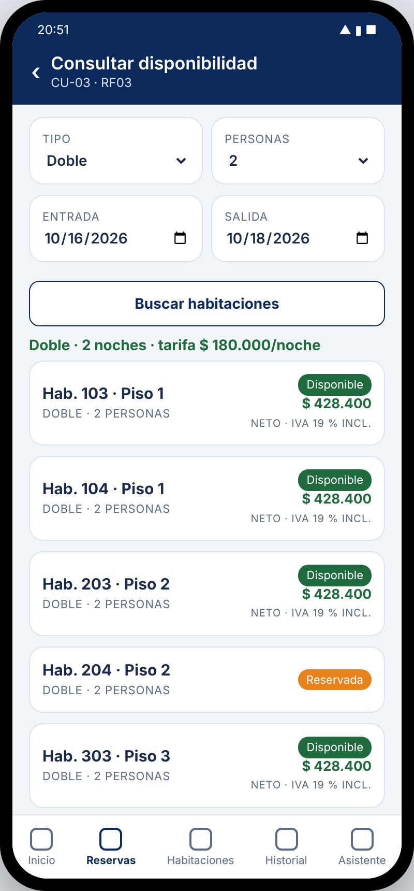
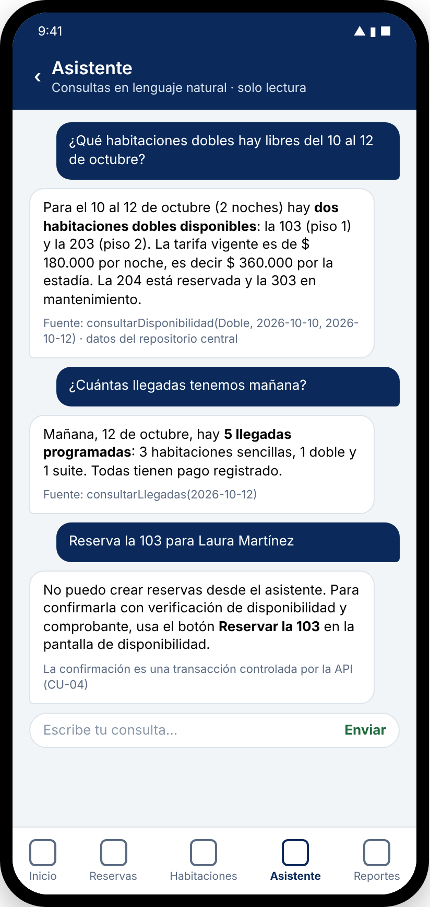
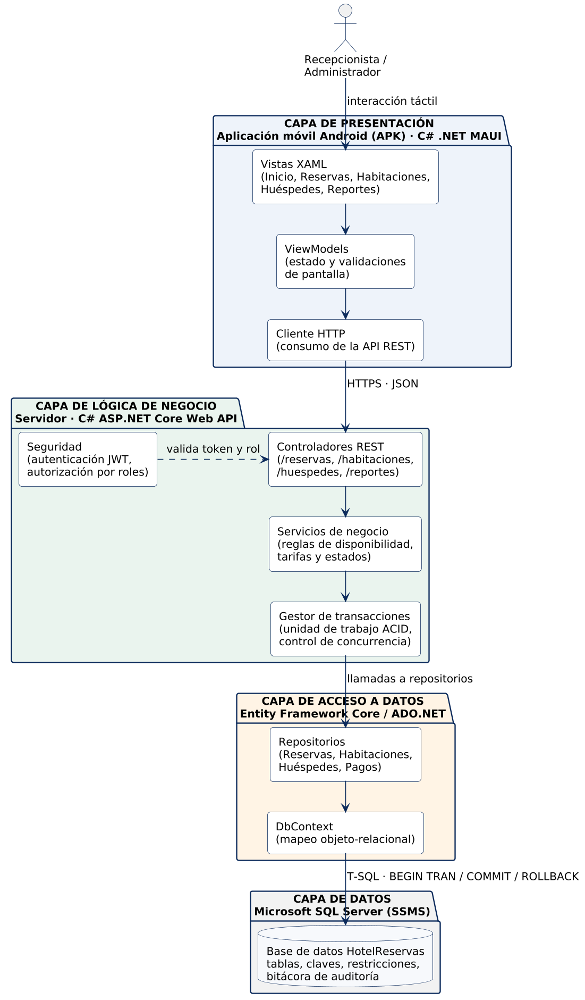
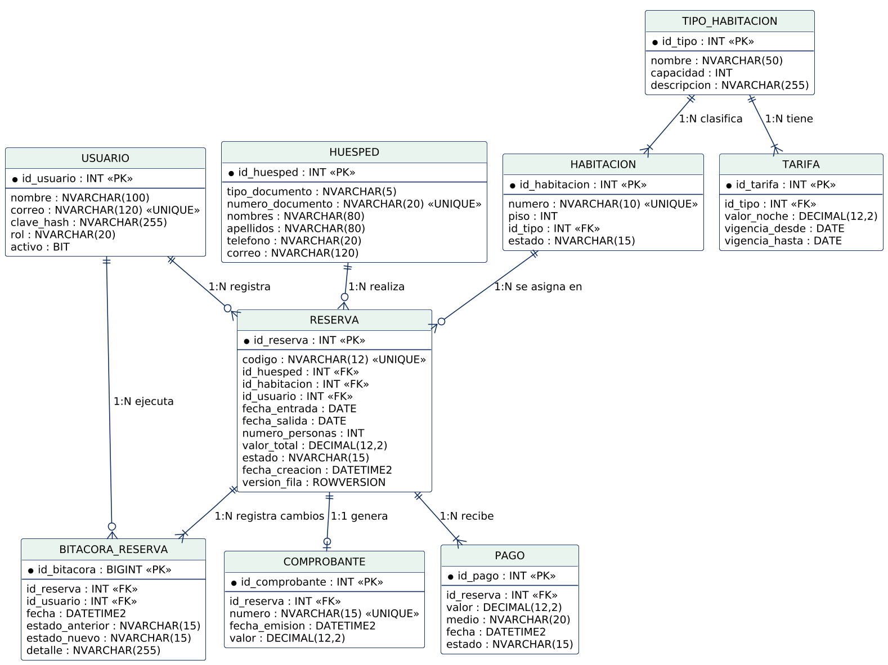
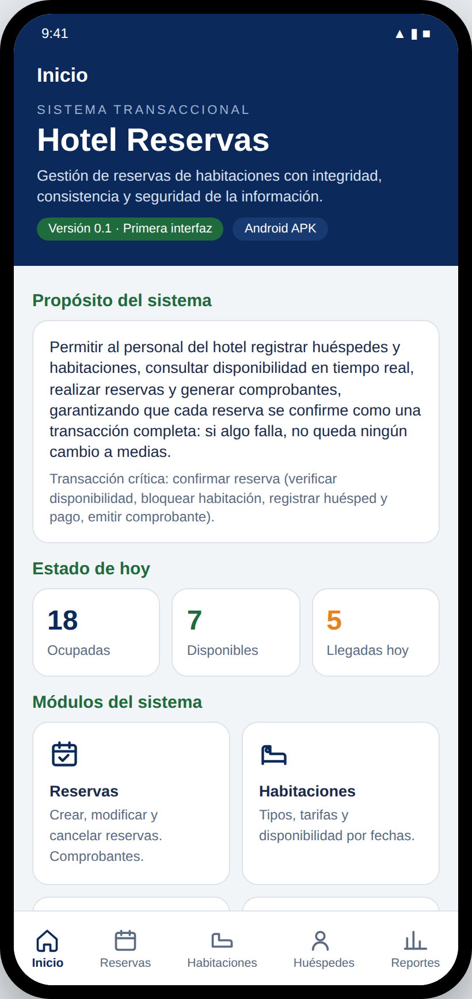

# Hotel Reservas

**Sistema Transaccional Móvil (APK) para la Gestión de Reservas de Habitaciones en un Hotel**

Universidad Manuela Beltrán · Ingeniería de Sistemas · Asignatura: Sistemas Transaccionales (7.° semestre)
Docente: Jamilton Fernando Benvides
Integrantes: Gustavo Adolfo Cardona Bayona · Jonathan Soler Guevara · Hugo Andrés Forero Angel

---

## Propósito general

Diseñar y construir un sistema transaccional, implementado como aplicación móvil Android (APK), que permita al personal de un hotel registrar huéspedes y habitaciones, consultar disponibilidad en tiempo real, realizar reservas, generar comprobantes y consultar reportes de ocupación, garantizando la integridad, la consistencia y la seguridad de la información.

La transacción crítica del sistema es **confirmar reserva**: verificar disponibilidad, bloquear la habitación para el rango de fechas, registrar el huésped y el pago, y emitir el comprobante, todo como una única unidad de trabajo con propiedades ACID. Si alguna parte falla, no queda ningún cambio a medias.

## Estado actual: Entrega S9 (Fase III: requerimientos, marcos y servicio de IA)

| Entrega | Contenido | Estado |
|---|---|---|
| S7 | Repositorio, primera interfaz (.NET MAUI) y navegación inicial | Entregada |
| S8 | Fase II: información general, objetivos, arquitectura, casos de uso, diagrama de clases y modelo relacional; scripts SQL del modelo y de la transacción | Entregada |
| S9 | Fase III: requerimientos funcionales (RF01 a RF15) y no funcionales (RNF01 a RNF05), MER y arquitectura de la base de datos, marco conceptual, marco contextual, marco integrador con el servicio de IA (modelo de datos, modelo de IA, lógica de integración, interfaz e infraestructura) y prototipo de pantallas | Entregada |
| S10 | Cálculo de impuestos y precio neto (RF16), comprobante compartible por WhatsApp (RF17) y reserva rápida para huésped frecuente (RF18); prototipo funcional en la APK v0.3; script 05 con el desglose de impuestos en la transacción; auditoría presencial | Entregada |
| **S11** | **API REST en ASP.NET Core (`HotelReservas.Api`): JWT, disponibilidad, confirmación transaccional vía `sp_ConfirmarReserva` (201/409), cambios de estado con ROWVERSION, huésped frecuente, comprobante compartible y el servicio de IA de la sección 13 (`/api/asistente`, Azure OpenAI con llamada a funciones de solo lectura + intérprete de reglas de respaldo, tabla `CONSULTA_ASISTENTE`)** | **Actual** |
| Siguiente | Conexión de la app a la API, CRUD de huéspedes, habitaciones y reservas | Pendiente |
| Final | Demostración de concurrencia (dos usuarios, última habitación) y pruebas | Pendiente |

### Qué se agregó en esta entrega (S11): la API y el servicio de IA

- **`HotelReservas.Api/`**: proyecto ASP.NET Core 8 + Entity Framework Core + SQL Server. Es la capa de lógica de negocio y de acceso a datos de la arquitectura en capas. Recursos: `POST /api/auth/login` (JWT), `GET /api/disponibilidad`, `POST /api/reservas` (ejecuta `sp_ConfirmarReserva`: 201 o **409** si la habitación ya no está disponible), `PUT /api/reservas/{codigo}/checkin|checkout|cancelar` (concurrencia optimista con `versionFila`), `GET /api/huespedes?documento=` (RF18), `GET /api/comprobantes/{numero}/compartir` (RF17) y `POST /api/asistente`.
- **Servicio de IA (sección 13 del documento) implementado en `HotelReservas.Api/Asistente/`**: `OrquestadorAsistente` (lógica de integración: filtro de datos personales → intérprete → validación contra el catálogo de solo lectura → ejecución → registro en `CONSULTA_ASISTENTE`), `CatalogoFunciones` (consultarDisponibilidad, consultarTarifa, consultarReserva, consultarLlegadas, consultarReservasConfirmadas), `InterpreteAzureOpenAI` (GPT-4o por Azure OpenAI Service con `tools`/`tool_choice`, mensaje de sistema que lo limita a los resultados de las funciones) e `InterpreteReglas` (respaldo sin internet con las mismas funciones). El asistente nunca crea, modifica ni cancela reservas.
- **`database/06_consulta_asistente.sql`**: tabla `CONSULTA_ASISTENTE` (modelo de datos del servicio de IA) y contraseñas de prueba (`Hotel2026*`) con PBKDF2 para los usuarios del script 03.
- Guía de ejecución y pruebas en `HotelReservas.Api/README.md` y `HotelReservas.Api/HotelReservas.Api.http`.

### Qué se agregó en la entrega S10

- **Impuestos y precio neto (RF16)**: la confirmación desglosa el valor en subtotal de alojamiento, IVA 19 % y precio neto; el huésped extranjero no residente queda exento de IVA (art. 481 E.T.). `database/05_impuestos_comprobante_huesped_frecuente.sql` agrega a `RESERVA` las columnas `subtotal`, `tasa_iva`, `impuesto` y `exento_iva` con la restricción `valor_total = subtotal + impuesto`, y actualiza `sp_ConfirmarReserva` para calcularlas dentro de la misma transacción.
- **Comprobante compartible por WhatsApp (RF17)**: tras confirmar, la app genera el texto del comprobante (`sp_TextoComprobante`) y lo envía al teléfono del huésped con WhatsApp, o lo copia al portapapeles; disponible también desde el historial.
- **Reserva rápida para huésped frecuente (RF18)**: con el número de documento la app reconoce al huésped con dos o más estadías (`sp_HuespedFrecuente`), muestra sus preferencias y precarga la consulta de disponibilidad y la confirmación: una reserva habitual en tres toques.
- Documento maestro actualizado (RF16 a RF18 en la Tabla 2, ajuste del diseño de datos en 7.3, concepto de precio neto en 11.1, Figuras 10 a 14 del prototipo funcional) y ficha de requerimientos (RF-11 a RF-13).
- APK v0.3: `Resources/Raw/prototipo.html` actualizado y `PrototipoPage` abre los enlaces externos (wa.me) con la app de WhatsApp del teléfono.

<p align="center">
  
  
  
</p>

### Qué se agregó en la entrega S9

- `docs/FaseII_y_III_Documentacion_Proyecto_Hotel_Reservas.pdf` (y `.docx`): documento maestro con las secciones de la Fase II corregidas según la retroalimentación del docente (cardinalidades alineadas entre el diagrama de clases y el modelo relacional, cierre de la sección de integración, revisión de formato) y las nuevas secciones de la Fase III:
  - 9. Requerimientos funcionales: RF01 a RF15, uno por cada caso de uso, con actor y resultado esperado.
  - 7.1 Modelo entidad-relación (MER) y 7.5 Arquitectura de la base de datos.
  - 10. Requerimientos no funcionales: RNF01 a RNF05 (seguridad, integridad, rendimiento, usabilidad y trazabilidad), cada uno con criterio verificable.
  - 11. Marco conceptual: conceptos del dominio hotelero, de sistemas transaccionales (ACID, concurrencia, aislamiento, bitácora) y de la pila tecnológica.
  - 12. Marco contextual: contexto, problemática, usuarios, necesidad, descripción del producto y alcance.
  - 13. Marco integrador: asistente de consultas en lenguaje natural con Azure OpenAI Service, descrito por componentes (modelo de datos, modelo de IA, lógica de integración, interfaz de usuario e infraestructura); solo documentado, no se implementa en esta fase.
  - 14. Prototipo: pantalla de inicio (.NET MAUI) y pantallas de alta fidelidad de disponibilidad, confirmación de reserva y asistente (`docs/prototipo/`).
- `docs/diagramas/`: diagrama de clases y modelo relacional actualizados, MER (`modelo-entidad-relacion.png` + `.svg`), arquitectura de la base de datos (`arquitectura-base-de-datos.png` + `.puml`), componentes del asistente de IA (`asistente-ia-componentes.png` + `.puml`) y secuencia del asistente (`asistente-ia.png` + `.puml`).
- `docs/fichas/`: ficha de requerimientos del sistema (RF-01 a RF-13, RNF-01 a RNF-05) y ficha de auditoría presencial con el encabezado diligenciado.

### Servicio de inteligencia artificial propuesto

Asistente de consultas en lenguaje natural (Azure OpenAI Service con llamada a funciones), ubicado en la capa de lógica de negocio como componente de la API. Interpreta preguntas como "¿qué habitaciones dobles hay libres del 10 al 12?" y las traduce en llamadas a funciones de solo lectura (consultar disponibilidad, consultar reserva, llegadas del día). Nunca crea, modifica ni cancela reservas: la confirmación (CU-04) sigue siendo una transacción ejecutada por el recepcionista desde la pantalla habitual, con el bloqueo descrito en la sección 7.2.

<p align="center">
  
</p>

### Prototipo de pantallas (Fase III)

<p align="center">
  
  
  
</p>

## Arquitectura (en capas, cliente-servidor)

<p align="center">
  
</p>

| Capa | Responsabilidad | Tecnología |
|---|---|---|
| Presentación | Aplicación móvil Android (APK), patrón MVVM | C# · .NET MAUI |
| Lógica de negocio | Servicios REST (JSON), reglas de negocio, coordinación de la transacción, autenticación JWT | C# · ASP.NET Core Web API |
| Acceso a datos | Repositorios, mapeo objeto-relacional, transacciones T-SQL | Entity Framework Core / ADO.NET |
| Datos | Persistencia, integridad referencial, bloqueos y aislamiento | Microsoft SQL Server (Express/Developer) + SSMS |

La app nunca accede a la base de datos directamente: toda operación pasa por la API sobre HTTPS. Si dos recepcionistas intentan reservar la última habitación al mismo tiempo, la base de datos serializa las dos transacciones (bloqueo `UPDLOCK, HOLDLOCK` + nivel de aislamiento `SERIALIZABLE`) y la API responde `HTTP 409 Conflict` a la segunda.

## Análisis y diseño (Fase II)

| Diagrama | Archivo | Descripción |
|---|---|---|
| Modelo entidad-relación (MER) | [`docs/diagramas/modelo-entidad-relacion.png`](docs/diagramas/modelo-entidad-relacion.png) | Notación de Chen: 9 entidades, 3 entidades débiles, cardinalidades mínimo..máximo |
| Arquitectura de la base de datos | [`docs/diagramas/arquitectura-base-de-datos.png`](docs/diagramas/arquitectura-base-de-datos.png) | Instancia SQL Server, esquema, reglas, índices, procedimiento, log y copias, acceso vía API |
| Componentes del asistente de IA | [`docs/diagramas/asistente-ia-componentes.png`](docs/diagramas/asistente-ia-componentes.png) | Modelo de datos, modelo de IA, lógica de integración, interfaz e infraestructura (Fase III) |
| Flujo del asistente de IA | [`docs/diagramas/asistente-ia.png`](docs/diagramas/asistente-ia.png) | Secuencia app, API, servicio de IA y base de datos (Fase III) |
| Casos de uso UML | [`docs/diagramas/casos-de-uso.png`](docs/diagramas/casos-de-uso.png) | Actores Recepcionista y Administrador; casos CU-01 a CU-15 con relaciones `include`/`extend` |
| Diagrama de clases UML | [`docs/diagramas/diagrama-clases.png`](docs/diagramas/diagrama-clases.png) | Usuario (Recepcionista, Administrador), Huesped, TipoHabitacion, Habitacion, Tarifa, Reserva, Pago, Comprobante, BitacoraReserva, ServicioReservas |
| Modelo relacional | [`docs/diagramas/modelo-relacional.png`](docs/diagramas/modelo-relacional.png) | 9 tablas: USUARIO, HUESPED, TIPO_HABITACION, HABITACION, TARIFA, RESERVA, PAGO, COMPROBANTE, BITACORA_RESERVA |

<p align="center">
  
</p>

## Base de datos (SQL Server)

Los scripts se ejecutan en orden desde SQL Server Management Studio (SSMS):

| Script | Contenido |
|---|---|
| `database/01_crear_base_de_datos.sql` | Crea la base `HotelReservas` y las 9 tablas con claves primarias, foráneas, restricciones `CHECK`, columna `ROWVERSION` en RESERVA e índice para la consulta de disponibilidad |
| `database/02_transaccion_confirmar_reserva.sql` | Procedimiento `sp_ConfirmarReserva`: transacción ACID con `SERIALIZABLE`, `UPDLOCK/HOLDLOCK`, `TRY/CATCH`, `ROLLBACK` y errores `THROW` (50001 = habitación no disponible) |
| `database/03_datos_de_prueba.sql` | Usuarios, tipos, tarifas, 25 habitaciones y huéspedes de ejemplo |

Núcleo de la transacción crítica:

```sql
BEGIN TRANSACTION;
  IF EXISTS (SELECT 1 FROM RESERVA WITH (UPDLOCK, HOLDLOCK)
             WHERE id_habitacion = @hab
               AND estado IN ('CONFIRMADA','EN_CASA')
               AND fecha_entrada < @salida AND fecha_salida > @entrada)
    BEGIN ROLLBACK TRANSACTION; THROW 50001, 'Habitación no disponible', 1; END
  INSERT INTO RESERVA (...);  INSERT INTO PAGO (...);
  INSERT INTO COMPROBANTE (...);  INSERT INTO BITACORA_RESERVA (...);
COMMIT TRANSACTION;
```

## Aplicación móvil (entrega S7)

<p align="center">
  
</p>

La pantalla de inicio presenta el nombre y propósito del sistema, los módulos Reservas, Habitaciones, Huéspedes y Reportes, el resumen "Estado de hoy" (datos de ejemplo) y la navegación por pestañas (Shell TabBar). Todavía no está conectada a la API ni a la base de datos.

## Estructura del repositorio

```
HotelReservas/
├── HotelReservas.sln
├── HotelReservas/                    Proyecto .NET MAUI (net8.0-android)
│   ├── MauiProgram.cs
│   ├── App.xaml / AppShell.xaml      Arranque y navegación (TabBar, 5 rutas)
│   ├── Views/                        InicioPage y módulos en construcción
│   ├── Resources/                    Estilos, íconos, AppIcon, Splash
│   └── Platforms/Android/            MainActivity, MainApplication, AndroidManifest
├── database/
│   ├── 01_crear_base_de_datos.sql
│   ├── 02_transaccion_confirmar_reserva.sql
│   ├── 03_datos_de_prueba.sql
│   ├── 05_impuestos_comprobante_huesped_frecuente.sql   Impuestos, comprobante compartible, huésped frecuente
│   └── 06_consulta_asistente.sql     Tabla CONSULTA_ASISTENTE (IA) y contraseñas de prueba
├── HotelReservas.Api/                API REST ASP.NET Core 8 (lógica de negocio, acceso a datos, servicio de IA)
│   ├── Program.cs / appsettings.json JWT, EF Core, Swagger, configuración de Azure OpenAI
│   ├── Controllers/                  auth, disponibilidad, reservas, huéspedes, comprobantes, asistente
│   ├── Servicios/ServicioReservas.cs sp_ConfirmarReserva (409 en 50001), cambios de estado con ROWVERSION
│   ├── Asistente/                    Orquestador, catálogo de funciones de lectura, intérpretes (Azure OpenAI y reglas)
│   └── Data/                         DbContext y entidades (10 tablas)
├── docs/
│   ├── FaseI_Documentacion_Proyecto_S7_Hotel_Reservas.pdf
│   ├── FaseII_Documentacion_Proyecto_S8_Hotel_Reservas.pdf / .docx
│   ├── FaseII_y_III_Documentacion_Proyecto_Hotel_Reservas.pdf / .docx   Documento maestro vigente
│   ├── pantalla-inicio.png
│   ├── diagramas/                    PNG + fuente .puml (PlantUML) y .svg
│   ├── prototipo/                    Pantallas de alta fidelidad (PNG + HTML)
│   └── fichas/                       Fichas UMB de requerimientos y auditoría
└── README.md
```

## Cómo ejecutar

**Base de datos**

1. Instalar SQL Server 2025 Express o Developer (gratuitos) y SQL Server Management Studio.
2. Conectarse a la instancia (`localhost` o `.\SQLEXPRESS`).
3. Abrir y ejecutar, en orden, `01_crear_base_de_datos.sql`, `02_transaccion_confirmar_reserva.sql`, `03_datos_de_prueba.sql`, `05_impuestos_comprobante_huesped_frecuente.sql` y `06_consulta_asistente.sql`.
4. Probar la transacción con el ejemplo incluido al final del script 02. Para la prueba de concurrencia, ejecutar la misma llamada en dos ventanas de consulta al mismo tiempo: solo una confirma.

**API REST**

1. Con el SDK de .NET 8, en `HotelReservas.Api/` ejecutar `dotnet run` (o abrir el proyecto en Visual Studio y F5). Swagger queda en `http://localhost:5080/swagger`.
2. Revisar `appsettings.json`: cadena de conexión, `Jwt:Key` y, si se dispone de un recurso de Azure OpenAI, `AzureOpenAI:Endpoint`, `ApiKey` y `Deployment`; sin credenciales el asistente funciona con el intérprete de reglas.
3. Probar con `HotelReservas.Api.http`: login con `recepcion1@hotel.com` / `Hotel2026*` y luego `POST /api/asistente` con `{ "consulta": "¿qué dobles hay libres del 16 al 18 de octubre?" }`.

**Aplicación móvil**

1. Instalar Visual Studio 2022 (17.8 o superior) con la carga de trabajo **.NET Multi-platform App UI** y el SDK de Android.
2. Abrir `HotelReservas.sln` y seleccionar un emulador o dispositivo Android.
3. Ejecutar (F5). Para generar el APK:

```bash
dotnet build -f net8.0-android -c Release
```

## Documentos relacionados

- Ficha técnica del microproyecto (Sistemas Transaccionales).
- `docs/FaseI_Documentacion_Proyecto_S7_Hotel_Reservas.pdf`: contexto, problemática, necesidad y pregunta problema.
- `docs/FaseII_Documentacion_Proyecto_S8_Hotel_Reservas.pdf`: análisis y diseño (arquitectura, UML y modelo relacional), versión entregada en S8.
- `docs/FaseII_y_III_Documentacion_Proyecto_Hotel_Reservas.pdf`: documento maestro vigente con la Fase II corregida y la Fase III (requerimientos, marcos conceptual y contextual, servicio de IA).
